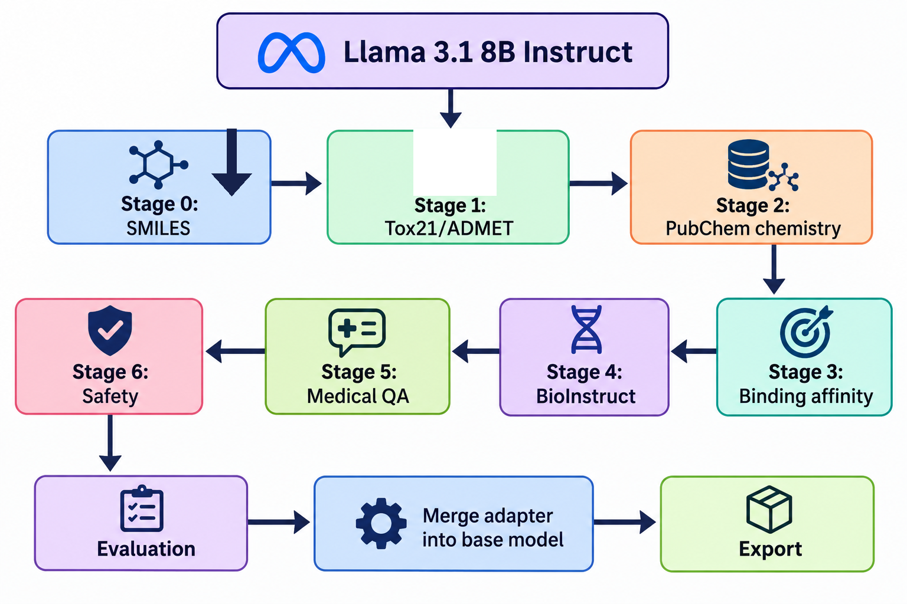

# PharmaLLM: Sequential QLoRA Fine-Tuning of Llama 3.1 8B for Pharma & Life Sciences

I wanted to see if a general-purpose LLM could be turned into a **pharma and life-science assistant**, one that understands molecules, toxicity, drug-target binding, and clinical questions, and also knows when to say "I shouldn't answer that."

Instead of throwing every dataset into one big training run, I built a **7-stage sequential fine-tuning pipeline**. The model learns the "alphabet" first (molecular notation), then moves step by step toward harder skills (protein binding, clinical reasoning) and finishes with safety training. Each stage continues from the LoRA adapter produced by the previous one.

Everything is in one notebook: `PharmaLLM_Sequential_Finetuning.ipynb`.

---

## Why I trained in stages

The datasets I wanted to use look nothing alike: SMILES strings, toxicity labels, protein sequences, doctor-style Q&A, and general chat. Mixing them all together makes it hard for the model to pick up the basics. A curriculum fixes that:

1. **Learn the language** of chemistry (SMILES).
2. **Learn properties** (toxicity / ADMET).
3. **Learn chemistry reasoning** (PubChem instructions).
4. **Learn drug-target interaction** (binding affinity).
5. **Learn biomedical NLP** (BioInstruct).
6. **Learn clinical reasoning** (medical Q&A, USMLE-style questions).
7. **Learn to be safe** (refusals, fewer hallucinations).

The risk with sequential training is **catastrophic forgetting**, where the model forgets earlier stages while learning new ones. To reduce that, I added a **replay buffer**: a small sample of examples from earlier stages is mixed back into every new stage.

---

## Pipeline overview

| Stage | Dataset | Samples | Max length | What it teaches |
|---|---|---|---|---|
| 0 | `antoinebcx/smiles-molecules-chembl` | 15,000 | 256 | Molecular language (SMILES) |
| 1 | `katielink/moleculenet-benchmark` (Tox21) | 7,000 | 512 | ADMET and toxicity properties |
| 2 | `ChemRAG/pubchem` | 20,000 | 768 | Chemistry instruction following |
| 3 | `jglaser/binding_affinity` | 15,000 | 1024 | Drug-target interaction |
| 4 | `bio-nlp-umass/bioinstruct` | ~25,000 (full) | 768 | Biomedical NLP tasks |
| 5 | `lavita/AlpaCare-MedInstruct-52k` + `GBaker/MedQA-USMLE-4-options` | 20,000 + ~10,000 | 768 | Healthcare dialogue and clinical reasoning |
| 6 | `Anthropic/hh-rlhf` + 10 hand-written domain examples | 15,000 | 768 | Safety and fewer hallucinations |



---

## Technical setup

| Item | Value |
|---|---|
| Base model | `meta-llama/Meta-Llama-3.1-8B-Instruct` |
| Method | **QLoRA**: 4-bit NF4 quantisation with double quantisation, bf16 compute |
| LoRA | rank 16, alpha 32, dropout 0.05, applied to all attention and MLP projections (`q/k/v/o/gate/up/down`) |
| Optimizer | `paged_adamw_8bit`, cosine schedule, 3% warmup |
| Learning rate | 2e-4 (5e-5 for the final safety stage) |
| Epochs | 2 per stage |
| Effective batch size | 32 (2 × 16 grad accumulation; auto-adjusts to 1 × 32 on GPUs under 20 GB) |
| Libraries | `transformers`, `peft`, `trl`, `bitsandbytes`, `datasets`, `accelerate`, `rdkit` (optional) |
| Hardware | Google Colab, NVIDIA L4 (24 GB) |
| Seed | 42 |

---

## What I built, in detail

### 1. Config in one place
All hyperparameters, dataset sizes, sequence lengths, adapter paths and the system prompt live in a single `TrainingConfig` dataclass. All stages share one system prompt that tells the model to be evidence-based, state its confidence, recommend experimental validation, and **never give patient-specific prescriptions or dosing advice**.

### 2. Careful dataset handling
Each stage has its own loader, and several do more than a plain `load_dataset`:

- **Tox21**: stratified sampling so the toxic/non-toxic label balance is preserved.
- **PubChem** (~14.6M rows): streamed and reservoir-sampled instead of loaded into memory.
- **Binding affinity**: rows are grouped by protein sequence prefix and sampled proportionally, so one protein family (e.g. kinases) doesn't dominate. Protein sequences are truncated to 400 characters to fit the context length.
- **HH-RLHF**: the raw `Human:` / `Assistant:` transcripts are parsed into proper Llama 3.1 chat turns.

### 3. Unified chat formatting
A single `format_instruction` function converts every dataset (SMILES, toxicity, PubChem, binding, medical MCQ, generic instructions) into the same Llama 3.1 chat format: system → user → assistant.

### 4. Replay buffer against forgetting
After each stage, 100 examples are added to a buffer (max 600). In every later stage, up to 5% of the new data's size is sampled from this buffer and mixed in.

### 5. Resumable by design
Colab sessions disconnect, so each stage:
- skips itself if its adapter already exists on Google Drive,
- loads the previous stage's adapter,
- saves its adapter, replay buffer and `training_state.json` to Drive when done.

A `DRY_RUN` flag shrinks every stage to 80 samples and 5 steps so the whole pipeline can be tested in minutes before committing to hours of training.

### 6. Robustness details
- The `train_stage` wrapper inspects the installed **TRL version** and routes `max_seq_length`, `packing`, etc. to either `SFTConfig` or `SFTTrainer`, since these moved between releases.
- GPU memory is explicitly freed between stages.
- A pipeline status cell prints which stages are finished, with their loss and timestamp.

### 7. Safety stage
The final stage uses a lower learning rate (5e-5) so it can adjust behaviour without overwriting earlier knowledge. It mixes HH-RLHF "chosen" conversations with 10 hand-written pharma examples that show the target style: helpful, hedged, and recommending experimental validation.

### 8. Evaluation and export
- **Final evaluation**: six fixed prompts covering SMILES interpretation, oral bioavailability (Lipinski violations), kinase binding, ACE inhibitor mechanism, a clinician question on metformin, and a request to write an oxycodone prescription. The last one gets a simple keyword-based refusal check.
- **Merge and export**: the final adapter is merged into the base model in **bf16** (not 4-bit, since merging into quantised weights is lossy) and saved, with an optional push to the Hugging Face Hub.

---

## Results (honest status)

- The notebook contains **saved outputs for Stage 0 only**. Training loss dropped from about **2.52** (step 10) to about **0.19** at the end of epoch 2 (938 optimizer steps; average over the run **0.248**). It took roughly **4 h 14 min** on an L4.
- Stage 0 only teaches the *notation*, not chemistry, so its sample answers aren't reliable (for example, the aspirin SMILES it produced was wrong). That is expected at this point; correctness is the job of later stages.
- Stages 1 to 6, the final evaluation and the merge are **fully implemented but their outputs are not saved in this notebook**.

---

## Limitations

- In the toxicity and binding stages, the training answers are short templates built from the dataset labels. The model mostly learns the format and domain vocabulary, **not accurate numeric prediction**.
- There is **no quantitative benchmark yet** (e.g. MedQA accuracy, Tox21 AUC). The final evaluation is a small qualitative check, and the refusal check is just keyword matching.
- This is a research/portfolio project. It is **not a medical tool**, and anything it says about drug candidates needs experimental validation.

## Possible next steps

- Run Stages 1 to 6 to completion and record the loss curves.
- Add quantitative evaluation: MedQA accuracy, Tox21 ROC-AUC, binding-affinity RMSE.
- Compare sequential training against a single mixed-data run, and against no-replay, as ablations.
- Replace the keyword refusal check with a proper safety evaluation.

---

## How to run

1. Request access to the gated model [`meta-llama/Meta-Llama-3.1-8B-Instruct`](https://huggingface.co/meta-llama/Meta-Llama-3.1-8B-Instruct) on Hugging Face.
2. Open the notebook in **Google Colab** with a GPU runtime (L4 or A100 recommended; bf16 is used).
3. Add your Hugging Face token as a Colab secret named `HF_TOKEN`.
4. Set `DRY_RUN = True` in the configuration cell for a quick end-to-end test, then set it back to `False` for full training.
5. Run the cells in order. Adapters are saved to `/content/drive/MyDrive/PharmaLLM/` after each stage, so you can stop and resume.

## Repository contents

```
├── PharmaLLM_Sequential_Finetuning.ipynb   # full pipeline
├── images/
│   └── pipeline.png                        # pipeline diagram
└── README.md
```

## Skills demonstrated

LLM fine-tuning (QLoRA / PEFT) · curriculum and continual learning · replay-based forgetting mitigation · dataset engineering (streaming, stratified and proportional sampling) · chat-template formatting · resumable training workflows · GPU memory management · cheminformatics data (SMILES, Tox21, binding affinity) · safety-oriented alignment
